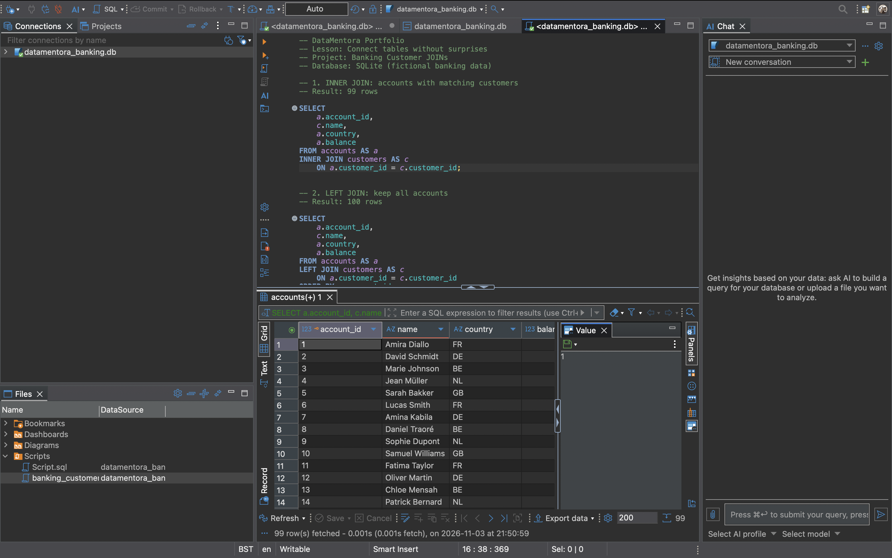

# Banking Data Analysis Portfolio

## Project 1: Customer Accounts and SQL JOINs

**Status:** Learning project — initial SQL queries tested using synthetic data.

### Objective
Analyse a fictional banking database to understand relationships between customers and accounts and identify missing customer information.

### Tools
- SQLite
- DBeaver Community
- SQL
- GitHub

### Dataset
- 100 fictional bank accounts
- 25 customer records
- Two tables: `accounts` and `customers`

### SQL techniques demonstrated
- INNER JOIN to retrieve accounts with matching customers
- LEFT JOIN to retain all accounts
- NULL checks to identify unmatched records
- Basic data quality validation

### Results observed
- INNER JOIN: 99 account records
- LEFT JOIN: 100 account records
- Unmatched accounts: 1 (account ID 100)

### What I learned
A LEFT JOIN preserves records from the left table even when a matching record does not exist in the right table. An INNER JOIN only returns matching records.

This difference is important in financial reporting because incorrect joins can cause accounts to disappear from reports.

### Next steps
- Add validation queries
- Analyse account balances by country
- Develop further financial data quality checks

*All data is fictional and used for educational purposes.*

## SQL Execution Results

The following screenshots show queries executed in DBeaver against a synthetic SQLite banking database.

### 1. INNER JOIN — 99 matching accounts

The INNER JOIN returns 99 accounts with matching customer records.

### 2. LEFT JOIN — 100 accounts retained

The LEFT JOIN retains all 100 accounts, including the account without a matching customer.

### 3. Data Quality Check — 1 unmatched account

The unmatched-record query identifies account 100, which has a NULL customer_id and a balance of 4,243 in the synthetic dataset.

### Business Insight

Comparing INNER JOIN and LEFT JOIN results demonstrates how an INNER JOIN can exclude records without matching customer data. In a financial reporting pipeline, this could cause incomplete account-level reporting. A data quality check helps identify these records before downstream analysis.

**Validation:** 100 total accounts = 99 matched accounts + 1 unmatched account.

**Note:** All data is fictional and used solely for educational portfolio work. The screenshots document local SQL execution; GitHub does not execute the queries automatically.
